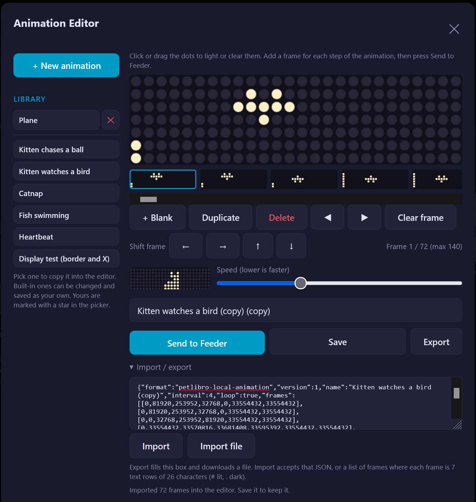
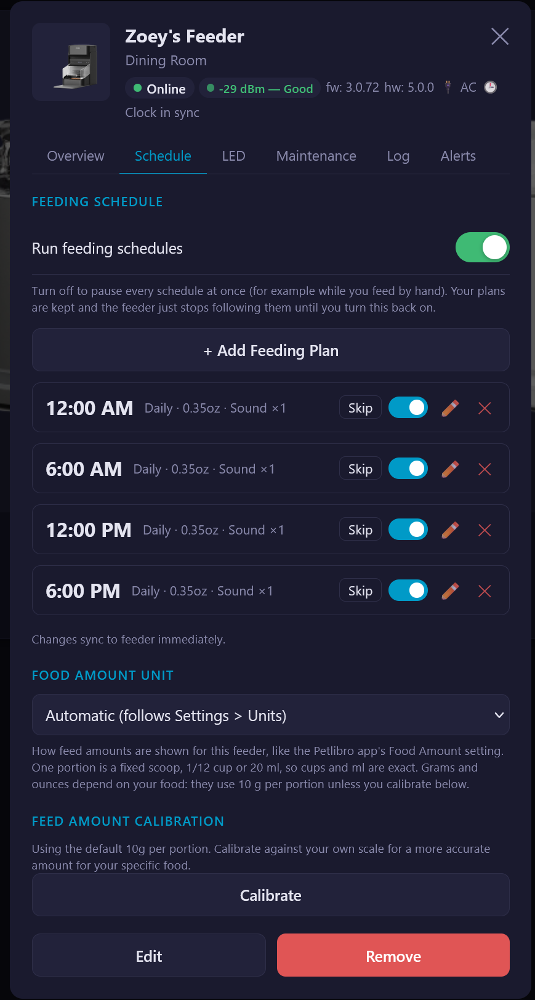

# Petlibro Local - Home Assistant App

> **dhaucke fork** of [smcneece/petlibro-local](https://github.com/smcneece/petlibro-local) with security hardening (see `CHANGELOG.md`): the web server only answers the Supervisor ingress proxy (except `/audio/*`, which feeders fetch directly), diagnostics no longer return Mosquitto logins, captured credentials only become a Mosquitto login after you confirm the device, logins the app did not create are never changed or removed, `hassio_role: manager` instead of `admin`, no `/share` mapping, and pinned base image and Python packages. Since 2026.10.3 it also has a per-device **Cloud relay** that keeps the official Petlibro app working alongside local control, and a German translation.

> **Setup note:** this is still a young project, though it has been running my own devices since mid-August. You should be comfortable with Home Assistant, Mosquitto broker configuration, and local DNS overrides before attempting setup.

Keep your Petlibro fountains and feeders running entirely on your local network. Petlibro Local intercepts your devices' MQTT credentials during setup, connects them directly to your Home Assistant Mosquitto broker, and gives you desktop and mobile control panel with no Petlibro cloud dependency after that.

[](https://github.com/dhaucke/petlibro-local/releases)
[](LICENSE)

> **Before you start:** your device first has to be connected to your Wi-Fi with the official Petlibro app (that one-time setup needs the app and a Petlibro account). Once it's on your Wi-Fi, it can run 100% locally, with no cloud and no internet access at all.

> **Is your device on newer firmware than the ones I've tested?** I've seen One RFID feeders on firmware 3.0.72 (hardware 5.0.0) and 2.0.47 (hardware 4.0.0), and Dockstream 2 fountains on 0.0.34 (hardware 1.0.0). I have no version for the other models. Newer firmware may behave differently, for example in whether the device still reboots when Mosquitto restarts (see [Restarting Mosquitto Reboots Your Devices](#restarting-mosquitto-reboots-your-devices)).

> ⚠️ **Installation type**: Petlibro Local is a Home Assistant App requiring a Supervisor-managed installation (HA OS or HA Supervised). Home Assistant Core and Home Assistant Container are not supported.

---

## Disclaimer

Petlibro Local is an independent, community-developed project and is **not affiliated with, endorsed by, or supported by Petlibro or its parent company** in any way. "Petlibro" is a trademark of its respective owner. Use of that name here is solely for identification purposes.

This software is provided **"as is", without warranty of any kind**, express or implied, including but not limited to warranties of merchantability, fitness for a particular purpose, or non-infringement. The authors and contributors accept no liability for any damage to devices, data loss, voided warranties, disruption of pet care routines, or any other direct or indirect harm arising from the use or inability to use this software.

By installing and using Petlibro Local you acknowledge that:

- It works by intercepting your device's MQTT credentials and redirecting traffic away from the Petlibro cloud, a deliberate local-network configuration change that **may void your device warranty**.
- It is still maturing software. Features may break, change, or disappear without notice.
- You are responsible for maintaining an adequate care routine for your pets independent of any automation software.

If you are not comfortable with these terms, do not use this software.

---

## Supported Devices

| Device | Serial Prefix | MQTT Model | Status |
|--------|--------------|------------|--------|
| Dockstream 2 Smart Fountain (black) | WF03...BD... | PLWF106 | Supported |
| Dockstream 2 Smart Fountain (white) | WF03...BA... | PLWF106 | Supported |
| Dockstream 2 Smart Fountain (white) | WF01 | PLWF106 | Supported |
| Dockstream 2 Cordless Fountain (black) | WF04...BD... (inferred) | PLWF116 | Beta |
| Dockstream 2 Cordless Fountain (white) | WF04...BA... (inferred) | PLWF116 | Beta |
| Dockstream RFID Smart Fountain | WF02 | PLWF305 | Beta |
| One RFID Smart Feeder | AF06 | PLAF301 | Supported |
| Granary Smart Feeder | AF01 | PLAF103 | Beta |

Notes on each model (the Granary's missing lid and RFID, the WF01 labeling, serial color codes, and the model numbers) are in [Supported device notes](docs/devices.md), along with the firmware versions I have seen.

---

## Screenshots

#### Mobile View


#### Desktop: Devices


#### Desktop: Device Detail


#### Desktop: Add Device


#### Feeder: Icon Editor


#### Feeder: Animation Editor


#### Feeder: Feeding Schedule


---

## How It Works

Petlibro devices connect to `mqtt.us.petlibro.com` over plain TCP port 1883. By pointing that hostname at your Home Assistant IP via local DNS (Pi-hole, AdGuard, or a router-level override), the device connects to your Mosquitto broker instead.

The first time you set up a device, Petlibro Local briefly stops Mosquitto and runs a lightweight MQTT listener that captures the device's credentials from its CONNECT packet. Those credentials are added to Mosquitto automatically, Mosquitto restarts, and the device reconnects and authenticates. From that point forward, no Petlibro cloud traffic is involved, and you can and should block the device from accessing the internet on your router if possible.

---

## What It Does

The full list, with details, is in [Features](docs/features.md). In short:

- **Fountains:** live water level, filter countdown, drink log, pump, light and light schedule controls
- **Feeders:** Feed Now, lid control, backup battery status, last fed and next meal, maintenance reminders for the food tank, desiccant, bowl and housing
- **Feeding schedules:** edit meals in the app, pause every schedule at once, or skip a plan's next feeding
- **Feed amounts:** show portions as cups, ounces, grams or milliliters, with an optional calibration for your food
- **Sound and LED (One RFID):** Device Sound hours, LED display hours, scrolling text, your own icons, built-in and custom LED animations with an animation editor, and custom feed sounds
- **Pets:** profiles, RFID eating tracking, activity timeline, and a "hasn't eaten" alert
- **Notifications:** in-app bell, Home Assistant notifications, email, and mobile push through the Home Assistant Companion app
- **Clock care:** feeders have no clock that survives a reboot, so Petlibro Local notices a wrong clock and corrects it without skipping or repeating a feeding
- **Home Assistant:** entities for everything, so automations, dashboards and voice assistants work. See [Home Assistant entities](docs/entities.md)

---

## Feed Amount Calibration (Optional)

The One RFID and Granary feeders dispense through a fixed-volume scoop rather than a scale, so one "portion" doesn't weigh the same for every food. By default I assume 10g per portion, and an optional calibration wizard on the Schedule tab shows real grams or ounces for your food. It only changes how amounts are *displayed*. The steps are in [Features](docs/features.md#feed-amount-calibration-optional).

---

## Requirements

- **The official Petlibro app, once**: to put a new device on your Wi-Fi in the first place. After that, nothing needs the app or the cloud.
- **Home Assistant OS** or **Home Assistant Supervised**: the Supervisor is required for app installation and the Supervisor API access the credential capture flow depends on.
- **Mosquitto broker app** (`core_mosquitto`): must be installed and running before Petlibro Local is installed. The app manages Mosquitto logins and stops/starts Mosquitto during credential capture (which reboots your devices for a minute or two, see [Restarting Mosquitto Reboots Your Devices](#restarting-mosquitto-reboots-your-devices)).
- **Local DNS override**: the hostname `mqtt.us.petlibro.com` must resolve to your Home Assistant IP on your local network. Pi-hole, AdGuard Home, and most router DNS overrides work. Without this, devices will continue connecting to the Petlibro cloud.

---

## Mosquitto Broker Setup

Petlibro Local needs a dedicated Mosquitto account to connect to the broker. The Mosquitto UI had an issue for me where the **Add User** button would sometimes silently append an extra character to the password, causing authentication failures, especially with long passwords. Use YAML mode if you have issues too.

1. In Home Assistant, go to **Settings → Apps → Mosquitto broker**.
2. Click the **⋮** menu (top right) and select **Edit in YAML**.
3. Add a dedicated account to the `logins` list. Use a straightforward password, username and password can be anything, avoid special characters to keep things simple:

```yaml
logins:
  - username: petlibro-local
    password: your_password_here
log_dest: []
log_type: []
require_certificate: false
certfile: fullchain.pem
keyfile: privkey.pem
customize:
  active: false
  folder: mosquitto
debug: false
```

4. Click **Save**. Mosquitto will restart automatically.
5. After the restart, re-open the Mosquitto configuration and **verify your entry still appears** in the `logins` list. The YAML editor occasionally does not persist the change on the first save; if the entry is missing, add it again and save a second time.

> **Note:** Petlibro device credentials captured during Auto Setup are added to this same `logins` list automatically by Petlibro Local. You do not need to add those manually.

---

## Installation

1. In Home Assistant go to **Settings → Apps → Install App**
2. Click the **⋮** menu (top right) and select **Repositories**
3. Click **+ Add** (bottom right corner)
4. Paste `https://github.com/dhaucke/petlibro-local` and click **Add**

Once the repository is added:

1. Find **Petlibro Local** in the App Store and click it.
2. Click **Install** and wait for the download to complete.
3. Enable **Start on boot**. Leave **Auto-update** off and review each update first.
4. Enable **Show in sidebar** for quick access.
5. Click **Start**.
6. Click **Open Web UI** or use the Petlibro Local link in the sidebar.

> ⚠️ **First run**: the Settings tab opens automatically if MQTT credentials are not configured. The app needs its own Mosquitto account (separate from device accounts). Create a dedicated user in the Mosquitto broker configuration, enter the credentials in the Settings tab, and tap Save Settings. A green indicator confirms the connection before you proceed to add devices.

---

## Adding a Device

First set up your DNS override and read the notes on keeping devices on your local broker, then use Auto Setup. The full DNS steps, router tips and the Mosquitto restart behavior are in [Networking](docs/networking.md).

### DNS Setup

`mqtt.us.petlibro.com` must resolve to your Home Assistant IP on your local network (Pi-hole: Local DNS Records, AdGuard Home: DNS Rewrites, or your router's custom DNS records). Check it with `nslookup mqtt.us.petlibro.com`. Step-by-step instructions are in [Networking](docs/networking.md#dns-setup).

### Keeping Devices on Local MQTT

Petlibro firmware appears to cache the cloud broker's IP address and falls back to it directly, bypassing DNS, if your local broker is unavailable even briefly. The most reliable fix is to **block the device from the internet** at your router. Some firmware never looks up the broker name at all, which needs a source-based NAT rule instead, and one firmware also asks a second DNS server (`8.8.4.4`). The details and the router rule are in [Networking](docs/networking.md#keeping-devices-on-local-mqtt).

### Cloud Relay (dhaucke fork)

Turn on **Cloud relay** when adding a device (or later under Edit) to keep the official Petlibro app working. The add-on connects to the Petlibro cloud with the device's own captured login and passes messages both ways. The device still has to reach your Home Assistant broker, so the redirect is still needed. Blocking the device itself from the internet stays fine: the cloud connection comes from Home Assistant, not from the device.

- With a DNS rewrite, enter the broker's public IP as **Cloud MQTT host** in Settings, since Home Assistant would otherwise resolve the name to itself (the relay refuses that).
- With a router redirect per device (destination NAT on port 1883 from the device's IP to Home Assistant), the name resolves normally. If the device and Home Assistant are in the same subnet, the router usually also needs a masquerade/source-NAT rule for that traffic, otherwise Home Assistant answers the device directly and the connection fails.
- While the cloud is reachable it answers the device, so manage feeding schedules in the Petlibro app. Without internet the add-on answers the device itself.

### Restarting Mosquitto Reboots Your Devices

In my testing, every time the Mosquitto broker restarts, the feeders and fountains reboot themselves and reconnect within a minute or two. That is firmware behavior, not something this app controls. Avoid restarting Mosquitto (or adding or removing a device here, which restarts it) near a feeding time. Restarting Home Assistant or Petlibro Local did not reboot my feeder. The full explanation, including what happens to the feeder's clock, is in [Networking](docs/networking.md#restarting-mosquitto-reboots-your-devices).

### Auto Setup (Recommended)

1. Open Petlibro Local and tap **Add Device**.
2. Select **Auto Setup** and read the instructions.
3. Tap **Start Capture**. Mosquitto stops and the app listens on port 1883.
4. Open the Petlibro app on your phone. Navigate to your device, tap the gear icon, and go to **Wi-Fi Settings**. Try **Reconnect** first. If the device does not appear within 30 seconds, try **Switch Wi-Fi** instead and walk through the Wi-Fi wizard, confirming the same network. The Petlibro app can be inconsistent about which option triggers a fresh connection; if one does not work, the other usually does.
5. When the device reconnects, credentials are captured automatically. The serial number and device type fill in from the captured data.
6. Pick the correct color variant, enter a display name and room, and tap **Add Device**.

Auto Setup stops Mosquitto for up to 60 seconds and reboots your devices (see above), so avoid it near a feeding time.

> **Tip:** If the app detects the device successfully but it still isn't connecting to Mosquitto afterward, try triggering the Wi-Fi reconnect in the Petlibro app a second time. Some devices need two reconnect attempts before they fully switch over to the local broker. Blocking the device from the internet may help too.

> ⚠️ **If other MQTT clients connect during capture** (camera systems, home automation bridges): the app filters by Petlibro serial number prefixes and ignores non-Petlibro clients. Capture continues until the Petlibro device connects or the 60-second timeout expires.

### Manual Setup

For cases where you already have the MQTT username and password (for example, from MQTT Explorer during a previous capture).

1. Open Petlibro Local and tap **Add Device**.
2. Select **Manual Setup**.
3. Select the device type and color variant.
4. Enter the serial number (printed on the label on the bottom of the device), MQTT username, and MQTT password. These can be captured separately using MQTT Explorer connected to port 1883 while the device connects.
5. Enter a display name and room, and tap **Add Device**.

---

## Home Assistant MQTT Discovery

Petlibro Local automatically publishes MQTT discovery messages so Home Assistant creates entities for every device, with no configuration. The MQTT integration must be enabled in Home Assistant, pointing at the same Mosquitto broker as the app. The feeder, Granary and fountain entity tables, notes on each entity, and an automation example for playing an LED animation are in [Home Assistant entities](docs/entities.md).

---

## Data and Backups

Petlibro Local stores all device configuration, pet profiles, and settings in a single JSON file managed by the Home Assistant Supervisor. This file is included automatically in standard Home Assistant full backups. Device credentials are stored only in this file and in the Mosquitto broker configuration; they are never sent to any external service.

---

## Configuration

All configuration is in the Settings tab inside the app UI.

| Setting | Description |
|---------|-------------|
| MQTT Host | Hostname or IP of the Mosquitto broker. Use `localhost` when Mosquitto is running as a Supervisor app (default). |
| MQTT Port | Broker port. Default is 1883. |
| MQTT Username | Username for the app's own broker connection. This should be a dedicated account, not a device account. |
| MQTT Password | Password for the above account. |
| Language | UI language. English is included. Translations welcomed! |

---

## FAQ

**Will I lose my PetLibro app pairing if I use this?**

No. The PetLibro app pairing lives in PetLibro's cloud; your device serial is tied to your account and the DNS override has no effect on that link. If you ever want to go back to cloud control, remove the DNS override and the device reconnects to PetLibro's MQTT broker on its own. The app picks it back up automatically. You may want to re-push your feeding schedules from the app once reconnected, just to make sure PetLibro cloud has a fresh copy.

**Do I need BIND? Can I use AdGuard Home or Pi-hole instead?**

AdGuard Home and Pi-hole both work fine. BIND, AdGuard, and Pi-hole all do the same thing here: a simple A record override. BIND's additional capabilities (reverse lookup, zone files) are not needed and offer no benefit for this setup.

**What happens if the app, Home Assistant, or Mosquitto restarts? Do I lose device control?**

Restarting Petlibro Local or Home Assistant itself doesn't affect your devices, since they only talk to Mosquitto. Restarting **Mosquitto** does: in my testing the feeders and fountains reboot themselves and come back within a minute or two. That is firmware behavior, newer firmware may well behave differently, and the details are in [Restarting Mosquitto Reboots Your Devices](#restarting-mosquitto-reboots-your-devices). Either way, configuration and pet profiles are stored in the Home Assistant Supervisor data directory and are included in standard Home Assistant backups.

---

## Acknowledgements

Device data structures, API field names, and device class patterns were informed by the [ha_petlibro](https://github.com/jjjonesjr33/ha_petlibro) Home Assistant integration by [@jjjonesjr33](https://github.com/jjjonesjr33) and contributors. That project reverse-engineered the Petlibro cloud API and documents the device property model that made this local MQTT app possible. If you want cloud-based control alongside or instead of local control, that integration is the place to start.

Thanks to [@MechanicalCoderX](https://github.com/MechanicalCoderX) for responsibly reporting a security issue (fixed in v2026.09.5), for packet-level findings on how some older feeder firmware connects, and for bug reports that led to several fixes.

Thanks also to [@Tp-danny](https://github.com/Tp-danny) for the Granary Smart Feeder capture and for testing feed amount calibration with a real scale, and to [@avgizmo](https://github.com/avgizmo), [@jemp](https://github.com/jemp) and [@JamieSBenson](https://github.com/JamieSBenson) for the logs and reports that helped track down the delayed-feeding problem.

Thanks to Reddit user u/ski_infection for a detailed analysis of how the One RFID feeder reboots and keeps its clock, and for notes on its LED display protocol and time-sync messages, which shaped the clock handling and the LED animations.
